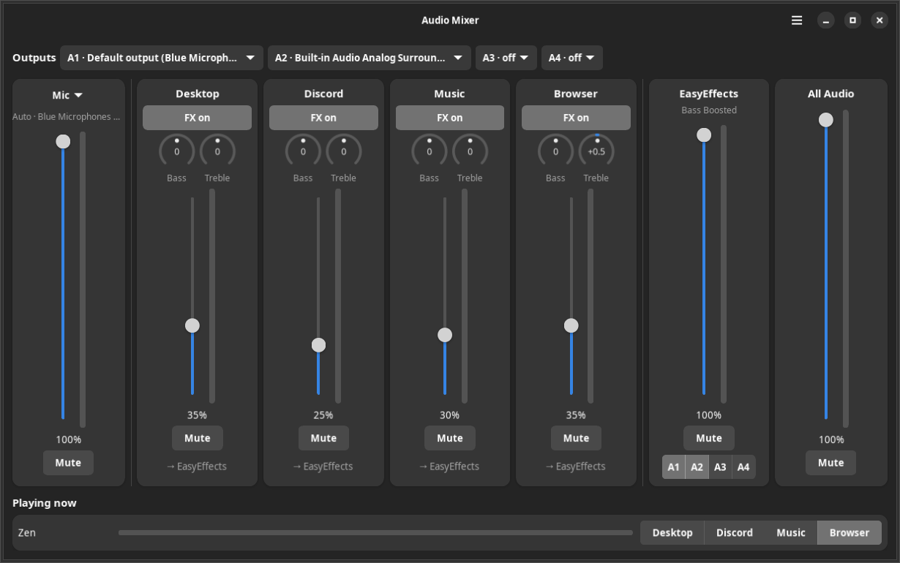
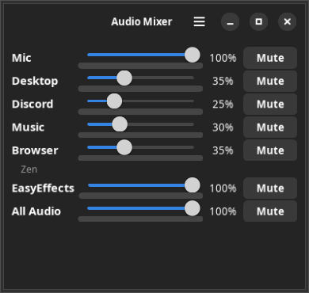
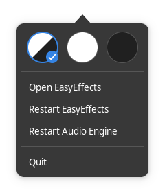

# Audio Mixer for Linux

**A VoiceMeeter-style mixer for Linux.** Give Discord, music, your browser and
everything else their own volume slider, effects and hotkeys — and keep them
apart.

[](https://pipewire.org/)
[](https://ubuntu.com/)
[](https://www.gnome.org/)



## What you get

- **Four separate channels** — Desktop (games and everything else), Discord,
  Music and Browser — each with its own volume, mute, Bass and Treble.
- **Your mic on its own strip**, through EasyEffects if you like.
- **Apps land on the right channel by themselves.** New ones go to Desktop and
  you pick their channel once, in the window.
- **Outputs A1–A4**: send any channel to your speakers, headset, HDMI… or
  through EasyEffects.
- **All Audio**: every channel mixed together, as an input for OBS or a
  recorder.
- **Hotkeys for everything** — right-click any button or fader to set one.
- **Survives reboots and reinstalls**: levels, mutes and settings come back,
  and a daily backup goes to your Nextcloud folder.

## Install

```bash
git clone https://github.com/CrazyGoGo42/my-audio-mixer-for-linux.git
cd my-audio-mixer-for-linux
./install.sh
```

That's it. The installer adds whatever is missing (EasyEffects included), sets
everything up and can safely be run again. You'll find **Audio Mixer** in your
app launcher; it also starts at login.

**You need:** Ubuntu 24.04 or newer (or another distro with PipeWire, GNOME and
libadwaita 1.5+), GNOME on X11 for the hotkeys, and a numpad for the default
hotkeys.

## The mixer window

Each strip has a volume fader with a live level meter, a mute button and the
level in %. From left to right:

| Strip           | What it's for                                                                 |
| --------------- | ----------------------------------------------------------------------------- |
| **Mic**         | Your microphone. Click its name to pick a different mic.                      |
| **Channels**    | **FX** on = through EasyEffects, off = plays dry on its own **A1–A4** outputs. |
| **EasyEffects** | Everything with FX on, after your EasyEffects preset, and where it plays.     |
| **All Audio**   | All channels mixed — pick it as an input in OBS (it doesn't include your mic). |

- **Bass and Treble knobs** (±12 dB): drag up or down to turn them,
  double-click to set them back to 0. Click one first and the mouse wheel or
  arrow keys turn it too.
- **Outputs** (top row): choose which device A1–A4 are. "Default output"
  follows your headset when you plug it in.
- **Playing now** (bottom): every app making sound. Click a channel to move the
  app there — for good. New apps are marked **NEW**.

### It fits any size

Make the window smaller and everything shrinks with it, step by step — no
scroll bars. Make it narrow (or short) and it turns into a compact mixer for a
corner of your screen:



### The menu



The **☰** button at the top:

- **Theme**: follow the system, light or dark.
- **Open EasyEffects** — its own window, for presets and effects.
- **Restart EasyEffects** if it acts up.
- **Restart Audio Engine** — the fix when a channel goes silent. Sound
  stops for a few seconds, then everything comes back with your levels.
- **Quit** (Ctrl+Q).

<br clear="right">

## Hotkeys

**Right-click** any mute button, fader or A1–A4 button in the window, click
**Change** and press the keys you want (Esc cancels). Every strip can have mute,
volume down and volume up keys; channels and EasyEffects can also have one per
output. A small overlay shows each change on screen.

The defaults:

| Channel | What goes here                      | Mute          | Volume down | Volume up   |
| ------- | ----------------------------------- | ------------- | ----------- | ----------- |
| Desktop | Games, wine/proton, everything else | `Ctrl+Num1`   | `Ctrl+Num4` | `Ctrl+Num7` |
| Discord | Discord                             | `Ctrl+Num2`   | `Ctrl+Num5` | `Ctrl+Num8` |
| Music   | YouTube Music, Spotify, Plexamp     | `Ctrl+Num3`   | `Ctrl+Num6` | `Ctrl+Num9` |
| Browser | Chrome, Firefox, Brave, Zen…        | `Ctrl+NumDel` | `Ctrl+Num+` | `Ctrl+Num-` |

A muted mic stays muted: changing its level doesn't unmute it, and it's still
muted after a reboot.

## Backup & reinstalling Ubuntu

Every day (and on every install) your channels, app routes, levels, hotkeys,
window settings, EasyEffects presets and sound card profiles are backed up to
`audio-mixer-backup/` in your **Nextcloud** folder (or `~/audio-mixer-backup`
without Nextcloud).

After a fresh Ubuntu install:

1. Install the Nextcloud client and let it sync (or copy the backup folder back).
2. Clone this repo and run `./install.sh` — it finds the backup and offers to
   restore it. Or point it at one: `./install.sh --restore /path/to/backup`.

## Troubleshooting

<details>
<summary><b>A channel is silent, or sound is missing after a reboot</b></summary>

Use **☰ → Restart Audio Engine** (or `audio-mixer restart engine`). It restarts
PipeWire safely and brings EasyEffects and your levels back. Don't restart
WirePlumber on its own — on this PipeWire version that disconnects everything.
</details>

<details>
<summary><b>An app went to the wrong channel</b></summary>

Click the right channel next to it under **Playing now**. It's remembered from
then on.
</details>

<details>
<summary><b>No sound after plugging in a headset</b></summary>

Give it a second — the outputs follow your default device. Check that the
**Outputs** row shows the headset.
</details>

<details>
<summary><b>All sound hardware is gone after a reboot</b></summary>

If `pactl list cards short` is empty, the kernel booted without its sound
drivers. Run `sudo apt install linux-modules-extra-$(uname -r)` and reboot.
</details>

<details>
<summary><b>Check the background services</b></summary>

```bash
systemctl --user status audio-router-daemon audio-osd easyeffects-watchdog
```
</details>

## Uninstall

```bash
./uninstall.sh
```

Removes the mixer, its services and hotkeys. Your EasyEffects settings and the
backup folder are left alone.

---

<details>
<summary><b>Command line</b></summary>

Everything the window does also works from a terminal:

```bash
audio-mixer status                     # what goes where
audio-mixer devices                    # outputs and mics you can pick
audio-mixer fx browser off             # Browser plays dry
audio-mixer slot A2 alsa_output.usb-…  # A2 = the headset
audio-mixer out browser A2 on          # Browser also plays on A2
audio-mixer out fx A2 on               # the EasyEffects strip also plays on A2
audio-mixer eq music bass 6            # +6 dB bass on Music
audio-mixer mic auto                   # or a device name from `devices`
audio-mixer hotkeys list               # every action and its keys
audio-mixer hotkeys set mic:mute "<Ctrl><Alt>m"
audio-mixer restart easyeffects        # or: restart engine
```

Your settings live in `~/.config/audio-mixer/`: `mixer.json` (FX, outputs,
Bass/Treble, mic), `hotkeys.json`, `routes.json` (which app goes where) and
`window.json` (window size and theme).
</details>

<details>
<summary><b>Customizing</b></summary>

- **Channels** — add, remove or rename them in
  `~/.config/audio-mixer/channels.conf`, then run `audio-routes-apply`.
- **Volume step per keypress** — `STEP` in `~/.local/bin/audio-channel-control`
  (default 1%).
- **Overlay position** — `TOP_MARGIN` in `~/.local/bin/audio-osd`.
- **App routing by hand** — edit `~/.config/audio-mixer/routes.json` (match by
  `binary` or `app` name) and run `audio-routes-apply`. Find an app's names with
  `pactl list sink-inputs | grep -E 'application.(name|process.binary)'`.
</details>

<details>
<summary><b>How it works</b></summary>

Each channel is a virtual PipeWire sink with its own volume and Bass/Treble
filters. Apps are placed on their channel **the moment they start** — PipeWire
is told where each app belongs before its stream exists — so nothing ever
blasts at full volume on the wrong output, and a restarted player comes back
on its own channel.

```
  Discord        Spotify        Chrome      games, new apps
     │              │              │                │
     ▼              ▼              ▼                ▼
 Discord_Audio  Music_Audio   Browser_Audio    Default_Audio   ← volume + Bass/Treble
     │              │              │                │            (Desktop)
     ├── FX on ──► EasyEffects ──► its A1–A4
     ├── FX off ─► the channel's own A1–A4 (speakers, headset, HDMI…)
     └── always ─► All Audio (input for OBS / recorders)

  real mic ──► Mixer Mic ──► EasyEffects (input effects) ──► apps' default mic
```

| Part                    | What it does                                                         |
| ----------------------- | -------------------------------------------------------------------- |
| `audio-mixer-window`    | The window (GTK 4 + libadwaita)                                      |
| `audio-mixer`           | Command line for FX, outputs, Bass/Treble, mic, hotkeys, restarts    |
| `audio-routes-apply`    | Builds the channel sinks and app routing rules                       |
| `audio-router-daemon`   | Keeps everything wired, restores levels at login, asks about new apps |
| `audio-channel-control` | What the hotkeys run                                                  |
| `audio-osd`             | The on-screen overlay for hotkeys                                    |
| `easyeffects-watchdog`  | Restarts EasyEffects if it dies or hangs                             |
| `audio-mixer-backup`    | The daily backup / restore                                           |
</details>

## License

MIT
